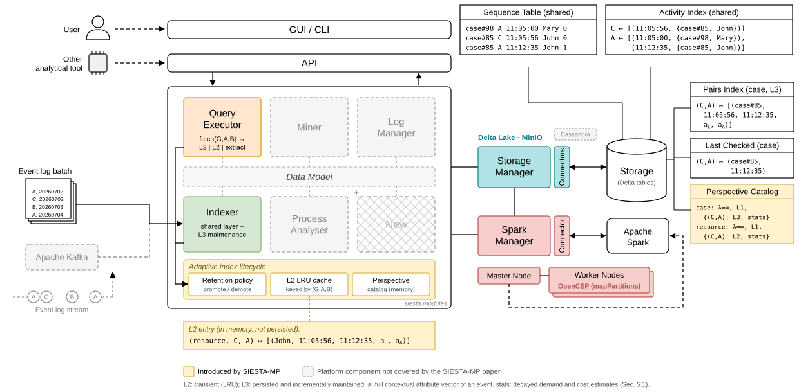

# Siesta Framework

> **VLDB Journal submission — reproducibility guide**
>
> This repository accompanies the manuscript *Workload-Adaptive Multiperspective Indexing for
> Attribute-Aware Queries over Evolving Sequence Databases* (SIESTA-MP). The table and commands
> below list, for every experiment of Section 6, the scripts that produce it, where they live and
> how to run them. Everything else in this README documents the framework itself.

## Reproducing the experiments (Section 6)

All experiment scripts live in [`tests/vldb_eval/`](tests/vldb_eval) and are run as modules **from the
repository root**, e.g. `python -m tests.vldb_eval.exp_warmup`. Results are written as JSONL under
`tests/vldb_eval/results/<experiment>/` (git-ignored); the plot scripts read them and write the
figures to `tests/vldb_eval/results/figures/` and tables to `tests/vldb_eval/results/tables/`.

### Prerequisites

1. Install the dependencies (see [Dependencies](#dependencies)) and start the SIESTA stack
   (`docker compose up --build siesta-api`, see [Docker](#docker-recommended-for-full-stack)).
   The system config used in the paper is `config/siesta.docker.config.json`
   (22 GB / 12-core budget: 5 GB driver container, 10.5 GB Spark worker).
2. Datasets (Table 3). The logs are not shipped with the repository and the scripts do not download
   them; place them in the repository's `datasets/` folder (the files are git-ignored):
   - BPIC 2011, 2012, 2015, 2017, 2018 (4TU.ResearchData, see the paper's references) as
     `datasets/bpic2011.xes`, `bpic2012.xes`, `bpic2015.xes`, `bpic2017.xes`, `bpic2018.xes`
     (the scale-out experiment writes its replicated BPIC 2017 logs to `datasets/scaleout/`).
     The synthetic log is generated. Prepare batches and canonical events with
     `python -m tests.vldb_eval.suite_data --datasets bpic2011 bpic2012 bpic2015 bpic2017 bpic2018 synthetic`
     and `python -m tests.vldb_eval.pattern_common export`.
   - BGL and HDFS from Loghub 2.0 (<https://zenodo.org/records/8275861>, `BGL.zip` and `HDFS.zip`),
     unpacked so that `datasets/loghub2_bgl/BGL/` holds `BGL_full.log` and
     `BGL_full.log_structured.csv`, and `datasets/loghub2_hdfs/HDFS/` holds `HDFS_full.log` and
     `HDFS_full.log_structured.csv`. Convert them with `python -m tests.vldb_eval.bgl_data` and
     `python -m tests.vldb_eval.hdfs_data`.
3. Competitors (Section 6.4), each given the same 16 GB / 12-core budget and run **one system at a
   time**:
   - ELK: `docker compose -f tests/vldb_eval/docker-compose-elk.yml up -d`
   - MR (Flink `MATCH_RECOGNIZE`): `docker compose -f tests/vldb_eval/docker-compose-flink.yml up -d`
   - LPG: Kuzu (embedded, installed with the test dependencies); the event-graph model follows
     `tests/vldb_eval/graphdb-eventlogs/`.

### Experiment → scripts

| Paper | Experiment | Run | Plot |
|---|---|---|---|
| Table 3 | Datasets and perspectives | `suite_data.py`, `bgl_data.py`, `hdfs_data.py` | — |
| Fig. 3a | Warm-up under a static log | `exp_warmup.py` | `plot_indexing.py --only fig3` |
| Fig. 3b | Skewed vs. uniform workloads | `exp_skew_vs_uniform_latency.py` | `plot_indexing.py --only fig3` |
| Fig. 4 | Hot-set size | `exp_hotset.py` | `plot_indexing.py --only fig4` |
| Fig. 5, Table 4 | Ingest cost avoided (Brute-force vs. SIESTA-MP) | `exp_maintenance_savings.py` | `plot_indexing.py --only exp5` (Fig. 5), `plot_indexing.py` (Table 4) |
| Fig. 6 | Pinned-pair sweep | `exp_maintenance_savings.py` | `plot_indexing.py --only pairsweep` |
| Table 5 | Space–time trade-off | `exp_space_time.py --parts 1 2` | `plot_section2.py` |
| Fig. 7 | Attribute-aware complex queries, case perspective | `pattern_complex.py`, `pattern_bgl.py`, `comp_siesta.py`, `comp_eql.py`, `comp_lpg.py`, `comp_mr.py` | `plot_long_combined.py` |
| Fig. 8 | Attribute-aware complex queries, BPIC 2017 `Action` / `org:resource` | `pattern_long.py`, `comp_siesta.py`, `comp_eql.py`, `comp_lpg.py` | `plot_long20.py` |
| Fig. 9 | Scale-out on replicated BPIC 2017 | `scaleout/replicate_bpic2017.py`, `scaleout/cluster.py`, `scaleout/workload_scaleout.py`, `scaleout/exp_scaleout.py`, `scaleout/exp_scaleout_persist.py` | `scaleout/plot_scaleout.py` |
| Fig. 10 | Retention-policy sensitivity | `exp_sensitivity.py` | `plot_section2.py` |
| §6.6 | Attribute representation (column-wise vs. map-based) | `bgl_data.py`, `hdfs_data.py`, `pattern_common.py`, `comp_siesta.py` | — |
| Fig. 11 | Embedded attributes vs. join-back | `exp_space_time.py --parts 3` | `plot_section2.py` |

Shared helpers (not run directly): `eval_common.py`, `indexing_common.py`, `workload.py`,
`batch_splitter.py`, `generate_eval_dataset.py`, `storage_common.py`.

### Commands

```bash
# Section 6.2 and 6.3 — adaptive indexing and indexing cost (Figs. 3-6, Table 4)
python -m tests.vldb_eval.run_indexing_suite --exp 1 2 3 4 --resume   # exp_warmup, exp_skew_vs_uniform_latency,
                                                                      # exp_hotset, exp_maintenance_savings
python -m tests.vldb_eval.plot_indexing

# Section 6.3 — space-time trade-off (Table 5) and Section 6.6 — join-back (Fig. 11)
python -m tests.vldb_eval.exp_space_time --datasets bpic2015 bpic2012 bpic2017 --parts 1 2 3

# Section 6.6 — sensitivity (Fig. 10)
python -m tests.vldb_eval.exp_sensitivity --sweeps eps cost drift
python -m tests.vldb_eval.plot_section2

# Section 6.4 — BPIC 2017 attribute perspectives (Fig. 8); 200 s timeout, one system at a time
python -m tests.vldb_eval.pattern_long generate
python -m tests.vldb_eval.comp_siesta --datasets bpic2017 --perspectives Action org:resource \
    --suite long20 --warm persist --timeout 200 --skip-after 3
python -m tests.vldb_eval.comp_eql --setup --dataset bpic2017 --perspectives Action org:resource \
    --timeout 200 --skip-after 3
python -m tests.vldb_eval.comp_lpg --datasets bpic2017 --case-only --setup --buffer-gb 12 --threads 12 \
    --suite long20 --plan stepwise --perspectives Action org:resource --timeout 200 --skip-after 3
python -m tests.vldb_eval.plot_long20

# Section 6.4 — case perspective, all logs (Fig. 7)
python -m tests.vldb_eval.plot_long_combined

# Section 6.5 — scale-out (Fig. 9), on a Docker Swarm cluster
python -m tests.vldb_eval.scaleout.replicate_bpic2017 --factors 1 2 3
python -m tests.vldb_eval.scaleout.cluster deploy --cores-max 18
python -m tests.vldb_eval.scaleout.exp_scaleout --sizes 1 2 3 --cores 3 6 9 12 15 18 --resume
python -m tests.vldb_eval.scaleout.exp_scaleout_persist --resume
python -m tests.vldb_eval.scaleout.plot_scaleout
```

Each script documents its options and output files in its module docstring (`--help`).

---

## The SIESTA framework

SIESTA is a Spark-based (PySpark) framework for indexing and querying event logs (sequence databases),
storing its indices as Delta Lake tables on MinIO object storage. It runs as a FastAPI server or as
module-oriented CLI jobs, and provides two indexing variants:

- **SIESTA (classical, case-centric)** — the original SIESTA. Every ingest batch eagerly builds and
  maintains an inverted index over *every* ordered activity pair of a single, predetermined grouping
  (the case id). Modules: `index` (ingestion) and `query` (detection, exploration, statistics).
  

- **SIESTA-MP (adaptive, multiperspective)** — the generalized SIESTA. Events are
  ingested once into a shared base layer; activity-pair indices are materialised per *grouping
  perspective* (any attribute-derived grouping, e.g. `org:resource`) and only for the pairs that the
  query workload demands, under a cost-based retention lifecycle. Modules: `adaptive_index` and
  `adaptive_query`.
  

Indexing every pair of every perspective eagerly (one SIESTA run per perspective) is referred to as
*Brute-force* in the paper. In both variants each pair record embeds the attribute vectors of both
events, so attribute predicates and cross-event bindings are evaluated in-index.

Core data assumptions:

- `trace_id` is a string
- `activity` is a string
- `position` inside a trace (or group) is a 0-indexed integer, derived from the timestamp order


### Query language

Patterns are written in SeQL: sequences of activities (`A B C`), disjunction (`(A || B)`), Kleene
operators (`A*`, `A+`, `A?`), negation (`A !X B`: no `X` between the matched `A` and `B`), literal
attribute predicates (`A[org:resource="User_1"]`) and cross-event bindings (`A[res=$1] B[res=$1]`).
Matching uses skip-till-next-match semantics within an optional look-back window. Candidate groups
are pruned with pair indices and then validated per group with OpenCEP.

### Modules

| Directory | CLI name | API routes | Role |
|---|---|---|---|
| `siesta/modules/index` | `indexer` | `/indexing/run` | SIESTA: eager case-centric indexing |
| `siesta/modules/query` | `executor` | `/querying/detection`, `/querying/exploration`, `/querying/statistics` | SIESTA: queries over the eager index |
| `siesta/modules/adaptive_index` | `adaptive_indexer` | `/adaptive_indexing/run`, `/adaptive_indexing/register-perspective` | SIESTA-MP: shared-layer ingestion, perspective declaration, maintenance of persisted pairs |
| `siesta/modules/adaptive_query` | `adaptive_executor` | `/adaptive_querying/detection`, `/adaptive_querying/exploration`, `/adaptive_querying/statistics`, `/adaptive_querying/pair_coverage` | SIESTA-MP: multiperspective queries |
| `siesta/modules/mine` | `miner` | `/mining/run` | declarative constraint discovery |
| `siesta/modules/analyser` | `analyser` | `/analyser/...` | process analytics (directly-follows, durations, bottlenecks, DFG/BPMN/Petri net etc.) |
| `siesta/modules/manager` | `manager` | `/manager/...` | storage namespaces, logs and tables |

`adaptive_query` engages the adaptive planner only when a request carries `grouping_keys`; without
them it delegates to the eager `query` processors, so both variants can be served side by side.

### SIESTA-MP: adaptive multiperspective indexing

**Index structures.** The *shared base layer* is maintained on every ingest batch and never
replicated per perspective:
- `SequenceTable` — one row per event with all its attributes (optionally partitioned by a base
  grouping, e.g. the case id), with positions extended incrementally via `SequenceMetadata`;
- `ActivityIndex` — per-activity, timestamp-ordered occurrences with their full attribute vectors,
  from which any perspective can be projected.

On top of it, each perspective `G` with materialised pairs has a `PairsIndex_G` (records
`(group, ts_A, ts_B, attrs_A, attrs_B)` per pair `(A, B)`, extracted under skip-till-next-match) and
a `LastChecked_G` table of per-group watermarks for incremental maintenance. A perspective catalog
(Delta table, served by an in-memory singleton) records each perspective's state and the workload
statistics of its pairs.

**Lifecycle levels.**

| Level | Granularity | What exists |
|---|---|---|
| L0 — declared | perspective | The grouping is registered (e.g. via `perspectives` in the index config or `/adaptive_indexing/register-perspective`) but not yet queried; no perspective-specific structure, no maintenance. |
| L1 — established | perspective | Created on the first query under `G`; groups are computed on demand from the shared layer. No footprint. |
| L2 — cached (transient) | pair | The pair is extracted on demand and kept in a bounded LRU cache; entries are evicted or invalidated by ingestion, never maintained. |
| L3 — persisted | pair | The pair is materialised in `PairsIndex_G` with its `LastChecked_G` watermarks and maintained incrementally on every ingest. |

A query fetches each required pair from L3 if persisted, from the L2 cache if transient, and otherwise
extracts it from the shared layer (and caches it); all three paths return the same record format.

**Retention policy.** Query demand `f_t(G,A,B)` and ingest frequency `b_t` are exponentially decayed
counts (half-life `h`). With an estimated build cost `c`, maintenance cost per batch `m̄` and saving
per query `s̄`, a pair is promoted to L3 after a query when `f_t·s̄ > (1+ε)(c + b_t·m̄)` and it has been
queried at least `n_min` times, and demoted at ingestion when `f_t·s̄ < (1−ε)·b_t·m̄`. The knobs
`half_life_seconds`, `min_query_count` and `hysteresis` (`ε`) are set in the adaptive index config and
can be overridden per query.

**Key components.**
- `adaptive_index/catalog.py` — perspective catalog: lifecycle state and per-pair workload statistics.
- `adaptive_index/retention.py` — retention policy: decay, promotion and demotion predicates.
- `adaptive_index/builders.py` — pair extraction, promotion and incremental maintenance.
- `adaptive_query/main.py` — query planner: pair sourcing (L3 / L2 / extraction), candidate pruning,
  pseudo-sequence reconstruction and CEP validation.
- `adaptive_query/lru_cache.py` — bounded LRU cache of transient (L2) pairs.
- `adaptive_query/automaton.py` — automaton validator for binding-free patterns.

## Project layout

- `main.py`: top-level entrypoint.
- `siesta/core`: framework bootstrapping (config, Spark, storage factory, interfaces).
- `siesta/model`: shared schemas and typed config/data models (system, storage, event, perspective structures).
- `siesta/modules`: feature modules (see [Modules](#modules)).
- `siesta/storage`: storage implementations (currently S3/MinIO-based).
- `config`: sample runtime and module config JSON files.
- `docker-compose.yml` + `siesta/dockerbase`: API + Spark + MinIO + Kafka stack.
- `tests`: unit tests (`tests/test_*.py`) and the evaluation harness of the paper (`tests/vldb_eval`).

## Dependencies

Requirements are split per submodule (`**/requirements.txt`).

Install all framework dependencies:

```bash
python3 siesta/install_dependencies.py
```

Install test dependencies:

```bash
python3 tests/install_dependencies.py
```

## Running Siesta

### 1. API mode

Default config (from siesta/model/SystemModel/DEFAULT_SYSTEM_CONFIG):

```bash
python3 main.py
```

Specific system config:

```bash
python3 main.py --config config/siesta.config.json
```

API routes are auto-registered from the modules as `/<module class>/<endpoint>` (see
[Modules](#modules)), e.g. `POST /indexing/run`, `POST /querying/detection`,
`POST /adaptive_indexing/run`, `POST /adaptive_querying/detection`.

### 2. CLI module mode

General pattern (the module is given by its CLI name):

```bash
python3 main.py --config <system_config.json> <module> <module_args>
```

Examples:

```bash
# SIESTA: eager indexing and querying
python3 main.py --config config/siesta.config.json indexer --index_config config/index.config.json
python3 main.py --config config/siesta.config.json executor --query_config config/query.config.json

# SIESTA-MP: adaptive indexing and querying
python3 main.py --config config/siesta.config.json adaptive_indexer --index_config config/adaptive_index.config.json
python3 main.py --config config/siesta.config.json adaptive_executor --query_config config/adaptive_query.config.json

# Mining
python3 main.py --config config/siesta.config.json miner --mining_config config/mining.config.json
```

## Configuration files

- `config/siesta.config.json`: local host-oriented system config.
- `config/siesta.docker.config.json`: container-network hostnames (`minio`, `kafka`, `spark-master`)
  and the Spark sizing used in the paper.
- `config/siesta.scaleout.config.json`: system config of the multi-node (Docker Swarm) deployment.
- `config/index.config.json`: SIESTA ingestion and field mappings.
- `config/adaptive_index.config.json`: SIESTA-MP ingestion, `perspectives` to declare at L0, retention knobs.
- `config/query.config.json`: SIESTA query method and payload.
- `config/adaptive_query.config.json`: SIESTA-MP query method, payload and `grouping_keys`.
- `config/mining.config.json`: mining categories, thresholds, output path.
- `config/analyser.config.json`: analyser settings.

## Docker (recommended for full stack)

Start API and dependencies:

```bash
docker compose up --build siesta-api
```

Use Docker-aware config explicitly (service-to-service hostnames):

```bash
SIESTA_CONFIG=/workspace/config/siesta.docker.config.json docker compose up --build siesta-api
```

This starts:
- `siesta-api`
- `spark-master`, `spark-worker`, `spark-worker2`
- `minio`
- `kafka`, `zookeeper`

`siesta/dockerbase` contains image definitions and entrypoints used by compose:
- `API/`: API container image and startup script.
- `Spark/`: Spark image and logging config.
- `Kafka/`: Kafka image and startup script.

### Spark: default vs. distributed execution

By default, `docker-compose.yml` runs Spark standalone on a single host: `spark-master` plus
`spark-worker`/`spark-worker2` (override their sizing via `SPARK_WORKER_CORES` /
`SPARK_WORKER_MEMORY`).

`sparkManager.py` resolves each Spark setting in this order: key in the `SIESTA_CONFIG` JSON →
`SPARK_*` env var → built-in default. With `config/siesta.docker.config.json`, driver and executor
memory (`spark_driver_memory`, `spark_executor_memory`) and `spark_cores_max` come from the JSON, so
the matching env vars have no effect unless those keys are removed; settings absent from the JSON
fall back to the env vars and then to Spark's defaults.

For distributed execution across several machines, the scale-out experiment deploys the stack on a
Docker Swarm with `python -m tests.vldb_eval.scaleout.cluster deploy` (one `siesta-api`/`spark-master`
node and one `spark-worker` per worker node, using `config/siesta.scaleout.config.json`); see
`tests/vldb_eval/scaleout/cluster.py`.

## Running tests

Unit tests:

```bash
pytest tests/
```

The evaluation harness (`tests/vldb_eval`) talks to a running SIESTA API at `http://localhost:8000`
(`API_BASE` in `tests/vldb_eval/eval_common.py`; per-request timeout via `EVAL_API_TIMEOUT`); see
[Reproducing the experiments](#reproducing-the-experiments-section-6).

## Extending Siesta (developer hints)

### Add a new module

1. Create `siesta/modules/<YourModule>/main.py`.
2. Implement a class that extends `SiestaModule`:
	- set `name` and `version`
	- implement `startup()`
	- implement `cli_run(args, **kwargs)`
	- optionally implement `register_routes()` for API endpoints
3. Add module-specific dependencies in `siesta/modules/<YourModule>/requirements.txt`.

Module discovery is automatic from `siesta.modules.*.main`.

### Add a new storage backend

1. Implement a new class extending `StorageManager` (see `siesta/core/interfaces.py`).
2. Add it under `siesta/storage/<Backend>/`.
3. Register it in `StorageManagerFactory._registry` (in `siesta/core/storageFactory.py`).
4. Set `storage_type` in system/module config to your backend key.

## Practical run order

1. Index a log with `indexer` (SIESTA) or `adaptive_indexer` (SIESTA-MP).
2. Query it with `executor` or `adaptive_executor` (or mine it with `miner`) on the same `log_name`
   and `storage_namespace`.
3. Check outputs under `output/` (and persisted data in the configured storage).
